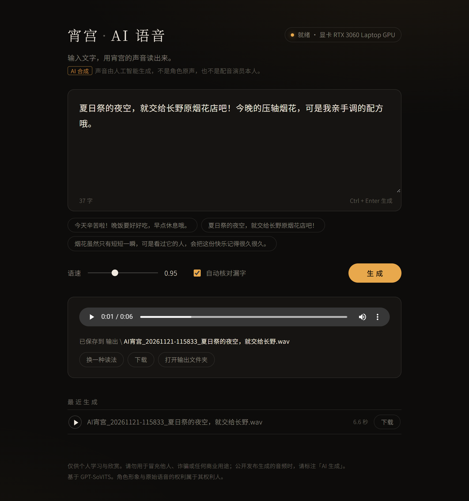

# 宵宫 · AI 语音

用《原神》角色宵宫的声音朗读任意中文文字。基于 [GPT-SoVITS](https://github.com/RVC-Boss/GPT-SoVITS) v2ProPlus 微调。

**[下载整合包](https://github.com/fireworksfade/yoimiya-ai-voice/releases/latest)，解压，双击就能用**：不用装 Python，不用配环境，也不用联网。

> [!IMPORTANT]
> 声音由 AI 合成，**不是**角色原声，也**不是**配音演员本人。仅供个人学习与欣赏，禁止商业用途。使用前请阅读[使用须知](#使用须知)。

## 下载和使用（Windows）

1. 打开 [Releases 页面](https://github.com/fireworksfade/yoimiya-ai-voice/releases/latest)，下载最新版本的**全部分卷**（v1.0 共 11 个：`Yoimiya-AI-Voice-v1.0-win64.7z.001` 到 `.011`，每个约 400 MB，共约 4.2 GB），放在同一个文件夹里。
2. 用 [7-Zip](https://www.7-zip.org/) 或 Bandizip 解压 `.7z.001`，其他分卷会自动接上。解压到路径短一点的地方，比如 `D:\`。
3. 打开解压出来的「宵宫AI语音」文件夹，双击 **`启动.bat`**。
4. 浏览器会自动打开页面。等右上角显示「就绪」（第一次大约半分钟），输入文字，点 **生成**。

生成的音频会自动播放，并保存在 `输出` 文件夹里。关闭黑色的命令行窗口即可退出。

> [!NOTE]
> 只下载源代码（绿色的 Code → Download ZIP）是不能直接运行的，一定要下载 Releases 里的整合包。

## 配置要求

| | |
|---|---|
| 系统 | Windows 10 / 11，64 位 |
| 显卡 | 推荐 NVIDIA RTX 20 系列或更新、显存 4 GB 以上。一句话大约几秒 |
| 没有 N 卡 | 也能用，会自动改用 CPU，但慢很多（一句话几十秒） |
| 磁盘 | 解压后约 9 GB |

本整合包里的 PyTorch 是 CUDA 12.8 版，不支持 GTX 10 系列及更早的显卡；遇到这类显卡，程序会自动改用 CPU。

## 功能

- **网页界面**：输入文字，调语速，一键生成；可以播放、下载，下面列着最近生成的音频。
- **长文本**：整篇文章直接粘贴进去即可。程序会按句子分组合成，每行算一段，段与段之间停得稍长一些。
- **自动核对漏字**：每组句子读完，用语音识别（Whisper small）核对一遍；发现漏读、多读，就换一种读法重读。仍对不上的句子会提示你听一下。
- **换一种读法**：同一段文字每次生成的结果相同。想要不同的语气，点「换一种读法」。
- **批量朗读**：把 `.txt` 文件拖到 `批量朗读.bat` 上，文件里每一行读成一个音频。
- **AI 标识**：生成的文件名以「AI宵宫_」开头，WAV 文件的信息里也写明了是 AI 合成。

## 常见问题

**浏览器没有自动打开**：把命令行窗口里的地址（例如 `http://127.0.0.1:9872/`）复制到浏览器。

**双击 `启动.bat` 提示找不到运行环境**：下载的是源代码，不是整合包。请到 [Releases](https://github.com/fireworksfade/yoimiya-ai-voice/releases/latest) 下载全部分卷。

**杀毒软件报毒或拦截**：整合包里是 Python 和 PyTorch 的运行文件，可能被误报，添加信任即可。

**某句读得不对**：点「换一种读法」，或者改一下标点再生成。

**能在别的设备上用吗**：网页只在本机打开（只监听 127.0.0.1），不会暴露到局域网或公网。

## 使用须知

- 本项目生成的所有声音都是 AI 合成的，**不是**角色原声，也**不是**配音演员本人的声音。
- 仅限个人学习、研究与欣赏，**禁止任何商业用途**。
- **禁止**用于冒充他人、诈骗、制作虚假或误导性内容，以及任何违法用途。
- 公开发布生成的音频时，请明确标注「AI 生成」（参见《人工智能生成合成内容标识办法》）。
- 角色「宵宫」及其原始语音的相关权利属于米哈游（miHoYo / HoYoverse）及配音演员。本项目与他们没有任何关联，也没有得到他们的授权或认可。
- 如果你是相关权利人，认为本项目侵犯了你的权益，请通过 Issues 联系，我会尽快处理或删除。

## 技术说明

| 部分 | 做法 |
|---|---|
| 音色模型（SoVITS） | 在 GPT-SoVITS v2ProPlus 底模上，用宵宫的游戏语音和一段约 49 秒的语调素材微调 |
| 语义模型（GPT） | GPT-SoVITS 原版底模 `s1v3.ckpt`；测试中，用语调素材微调它反而让语气变平 |
| 参考音频 | 语调素材开头一段作为主参考，另 5 句作为辅助参考，一起决定音色和音高 |
| 分句 | 只在句末切分，相邻句子凑成不超过 70 字的一组一起生成，句间衔接更自然 |
| 后处理 | 语速 0.95；句间停顿取她连续独白里实测的中位数；句内停顿缩短到 75%；按实测频谱差补回高频和谐波清晰度 |
| 自动核对 | faster-whisper small，按拼音比对：连续漏掉 3 个以上音节或多出 4 个以上才算出错 |

### 从源码运行（其他系统或开发者）

1. 获取 GPT-SoVITS（本项目使用 commit [`e91506f`](https://github.com/RVC-Boss/GPT-SoVITS/commit/e91506f1fba265e1841617c3042a1573206a7351)），按它的说明安装依赖，再安装 `pip install -r requirements.txt`。
2. 把本仓库的 `app.py`、`read_aloud.py`、`yoimiya`、`web` 复制到 GPT-SoVITS 根目录。
3. 从整合包里复制 `models` 文件夹，以及 `GPT_SoVITS/pretrained_models` 里的 `s1v3.ckpt`、`chinese-roberta-wwm-ext-large`、`chinese-hubert-base`、`sv`、`fast_langdetect`（也可以按 GPT-SoVITS 的说明下载底模）。
4. 运行 `python app.py` 打开网页，或 `python read_aloud.py "要读的文字"` 在命令行合成。

## 致谢与许可

- 本仓库的代码使用 [MIT 许可](LICENSE)。
- 模型权重（`models/`）和参考音频**不适用** MIT 许可，只能按上面的使用须知用于个人非商业用途。
- 整合包中包含的主要第三方项目：[GPT-SoVITS](https://github.com/RVC-Boss/GPT-SoVITS)（MIT）、[faster-whisper](https://github.com/SYSTRAN/faster-whisper)（MIT）及 OpenAI Whisper 模型（MIT）、[chinese-roberta-wwm-ext-large](https://huggingface.co/hfl/chinese-roberta-wwm-ext-large)（Apache-2.0）、[chinese-hubert-base](https://huggingface.co/TencentGameMate/chinese-hubert-base)、[g2pW](https://github.com/GitYCC/g2pW)（Apache-2.0）、[3D-Speaker ERes2NetV2](https://github.com/modelscope/3D-Speaker)（Apache-2.0）、fastText 语种识别模型（CC BY-SA 3.0）、PyTorch（BSD-3-Clause）。各自的许可以其项目为准。
